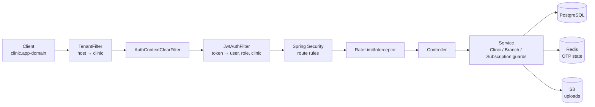
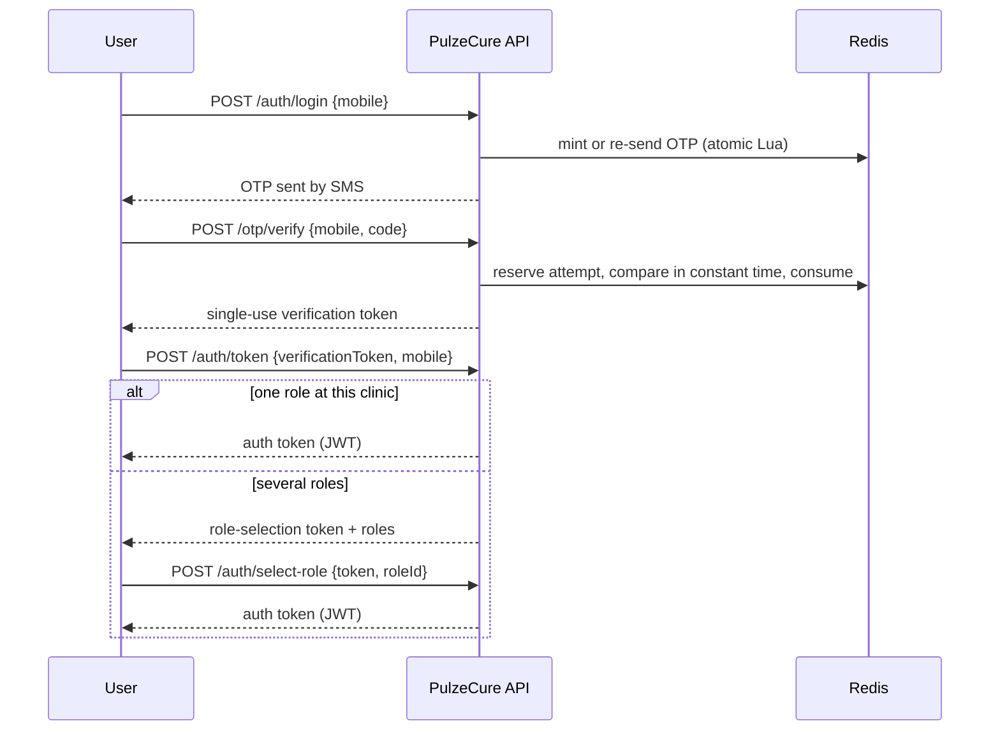

# PulzeCure

> A multi-tenant SaaS backend for clinic appointment booking and management, built with Spring Boot.


> **About this README:** The source repository is private. This page is a public overview of the project for reviewers and interviewers, covering what it does, how it is built, and the engineering decisions behind it.

Clinics sign up on their own and get an isolated workspace on their own subdomain, or on a custom domain. From there they manage branches, staff, doctors, recurring doctor schedules and patient bookings. Patients and guests book appointments with passwordless OTP login. Every clinic is a fully isolated **tenant**, and all clinics share one centrally managed deployment.

---

## At a glance

| | |
|---|---|
| Production code | ~12,600 lines of Java across 162 classes in 14 feature modules |
| Test code | ~16,700 lines, **580+ test cases** in 68 test classes |
| Test types | Unit, integration and **end-to-end over real PostgreSQL and Redis** (Testcontainers), plus deterministic **race-condition tests** |
| Database | 8 Flyway migrations, 18 tables, native Postgres enums, partial unique indexes, CHECK constraints |
| Design docs | 7 Architecture Decision Records (ADRs) |
| Infrastructure | Docker multi-stage image, Docker Compose, Terraform for AWS (VPC, RDS, ElastiCache, Secrets Manager) |

---

## Features

**Platform**
- Self-service clinic signup, verified by OTP, with a 14-day trial subscription created automatically.
- Each clinic is reached on `<subdomain>.<app-domain>` or on a verified custom domain.
- Super-admin tools to ban users and suspend doctors across the whole platform.

**Clinic management**
- **Branches:** multiple physical locations per clinic. Exactly one is always the head office (enforced in the application and backed by a partial unique index).
- **Team:** owners (up to 3 co-owners), admins, staff and doctors. Each role can see **all branches** or only **specific branches**.
- **Doctors:** one global identity that can work at many clinics. Each clinic keeps its own profile for the doctor (avatar, specializations, display name).
- **Patients:** each clinic keeps its own private record of a patient (date of birth, gender). Patients can be account holders or **dependents** (e.g. a child booked by a parent).

**Scheduling and booking**
- **Recurring schedules:** daily, weekly, biweekly, monthly, weekdays, weekends, or custom days of the week. A nightly job generates bookable sessions 30 days ahead.
- **One-off sessions** can be added outside any recurrence.
- Bookings have a queue number and a human-readable reference (`BK-0000001`), and are capped by session capacity.
- **Guest booking:** a visitor proves their mobile number with an OTP and books without creating an account first.
- Cancellation rules: patients can cancel up to 5 hours before the session; staff can cancel any time. Cancelling a session cancels all its bookings.
- **Automatic cleanup:** removing a doctor, suspending a doctor, removing a specialization, or deactivating a branch cancels the affected future sessions and their bookings.

**Subscriptions**
- Tiered plans (Basic, Pro, Max) with monthly or annual billing, seeded as data.
- Clinics with a lapsed trial or subscription are blocked from paid operations. Actions that shrink a clinic (removing members, closing branches) still work, so a clinic can always wind down.

---

## Engineering highlights

These are the parts of the project I would most like to discuss in an interview.

### 1. Tenant isolation, resolved from the host

- A `TenantFilter` runs first in the chain and resolves the clinic from the request host only: a verified custom domain or a subdomain of the app domain. Headers such as `X-Clinic-ID` are deliberately ignored, because clinic IDs are not secret and a header would let a request pick its own tenant.
- Requests to the bare app domain are platform traffic (signup, super admin) and run with no tenant.
- Unknown hosts get `404`. Repeated failed lookups are rate-limited (`429`) to stop subdomain enumeration.
- The JWT carries the clinic it was issued for. A token issued for clinic A is rejected on clinic B's host.
- The tenant context is a `ThreadLocal` and is always cleared in a `finally` block. A second filter clears authentication state as a safety net. Dedicated tests prove no state leaks between requests.
- Health checks (`/actuator/health`) skip tenant resolution, because a load balancer sends its own IP as the host.

### 2. Passwordless OTP authentication, designed against a written threat model

The OTP endpoints are unauthenticated, so they have to be safe when the caller is a stranger who knows someone's number. ([ADR 0001](#architecture-decision-records))

- All OTP state lives in Redis, and every state change is a **single atomic Lua script**, so concurrent sends and verifications cannot interleave.
- **Sending again re-delivers the pending code instead of overwriting it.** An attacker cannot replace the code a victim just received or reset the guess counter.
- **Codes are compared in Java with a constant-time comparison** (`MessageDigest.isEqual`), because Lua's `==` is not timing-safe. Redis then consumes the code only if it still holds the exact value that was compared, so exactly one concurrent caller can win.
- Verification and role-selection tokens are **single-use** and are claimed with `SET NX` *before* the JWT is parsed. This closes the check-then-use race.
- Every login failure returns the same message after a fixed delay, so responses don't reveal whether a number is registered, banned, or a member of the clinic.

### 3. Correctness under concurrency

Concurrent requests can change the same schedule, session or booking. Each race was identified, fixed with the narrowest lock that works, and covered by a test that reproduces it. ([ADR 0003](#architecture-decision-records))

- **No overbooking:** booking takes a `SELECT … FOR UPDATE` lock on the session row before checking capacity. The database also enforces `booked_count <= max_bookings`.
- **No overlapping schedules (write skew):** the overlap check inserts rows that don't exist yet, so there is nothing to lock. Instead, schedule changes lock the doctor's per-clinic row, which serializes them for that doctor.
- **No lost seats on double cancellation:** cancellation locks the session, then the booking, in the same order as every other writer to avoid deadlocks. It reads the IDs with a scalar query first, so Hibernate cannot hand back a stale cached entity.
- **First booking by the same person from two devices:** handled with `INSERT … ON CONFLICT DO NOTHING`. In Postgres a unique violation aborts the whole transaction, so it can't simply be caught and retried.
- **Signup rollback:** the clinic is provisioned in its own transaction so subdomain collisions can be retried. If the outer signup then fails, a transaction-completion hook removes the clinic again. ([ADR 0005](#architecture-decision-records))

Race tests use a small `Race` helper that releases N threads from one latch at the same instant, plus a `HeldInsert` helper that holds a transaction open to force a specific interleaving. This makes the tests deterministic rather than flaky.

```java
// cancelBooking: lock order matches every other writer. See ADR 0003.
UUID sessionId = bookingRepository
        .findSessionIdByIdAndClinicId(bookingId, clinicId)     // scalar: nothing enters the persistence context
        .orElseThrow(() -> new EntityNotFoundException("Booking not found"));
DoctorSession session = sessionRepository.findByIdForUpdate(sessionId).orElseThrow();   // 1. session
Booking booking = bookingRepository.findByIdAndClinicIdForUpdate(bookingId, clinicId)   // 2. booking
        .orElseThrow(() -> new EntityNotFoundException("Booking not found"));
// ...only now check status, ownership and the cancellation window
```

### 4. Layered authorization

| Layer | Checks |
|---|---|
| `SecurityConfig` | Which routes are public, authenticated, or super-admin only |
| `JwtAuthFilter` | User exists and isn't banned; the token's **own role** is still active (losing ADMIN kills an ADMIN token even if the user is still OWNER); the token's clinic matches the host |
| `ClinicAccessGuard` | The caller has a role allowed for the action at this clinic |
| `BranchAccessGuard` | The caller can access the branch involved, or has clinic-wide access for clinic-wide actions |
| Role hierarchy | Owners manage every non-owner role; admins manage staff, doctors and patients; staff manage patients. A branch-scoped user can't manage someone with wider access than their own |
| `SubscriptionGuard` | The clinic's trial or subscription is active (`402` otherwise) |

### 5. Rate limiting that can't be bypassed by spoofing

- Per-IP token buckets (Bucket4j and Caffeine) per endpoint group: OTP 3/min, auth 10/min, clinic signup 5/hour. OTP sends are also limited to one per minute per mobile number in Redis.
- `X-Forwarded-For` is trusted **only** from configured proxy CIDR ranges, and the client IP is found by walking the header from right to left. Hand-written IP parsing rejects hostnames, so attacker input never triggers a DNS lookup. ([ADR 0002](#architecture-decision-records))

### 6. Queries and data integrity

- Optional-filter listings are built with Spring Data **Specifications** and the Criteria API rather than `(:param IS NULL OR …)` JPQL. That pattern failed at parse time on PostgreSQL with untyped null parameters. ([ADR 0004](#architecture-decision-records))
- Every listing has a fixed, total sort order ending in `id`, so pages stay stable. Client `?sort=` is ignored on purpose, and page size is capped at 100. ([ADR 0006](#architecture-decision-records))
- Soft deletes keep history. **Partial unique indexes** (`WHERE deleted_at IS NULL`) allow one live row plus any number of historical ones.
- CHECK constraints encode business rules in the schema, for example a patient is *either* a linked account *or* a dependent with a guardian, never both.
- PATCH endpoints use `JsonNullable`, so an omitted field and an explicit `null` mean different things.

---

## Architecture

### Request pipeline



### Login flow



### Modules

The code is organized **by feature**. Each module owns its controller, service, DTO, entity and repository layers.

```
src/main/java/com/bootloaderlabs/pulzecure/
├── tenant/        TenantFilter, TenantContext, Clinic and Branch entities
├── auth/          OTP login, token exchange, role selection
├── otp/           OTP send/verify (Redis + Lua), single-use verification tokens
├── security/      SecurityConfig, JWT, access guards, rate limiting, client-IP resolution
├── clinic/        signup and provisioning, clinic settings, team membership
├── branch/        branches and head-office rules
├── user/          global users and per-clinic roles with branch scope
├── doctor/        global doctor identity, per-clinic profiles, specializations
├── patient/       global patients, dependents, per-clinic patient records
├── appointment/   recurrences, session generation, sessions, bookings, cancellation cascades
├── subscription/  plans, features, subscriptions, expiry job
├── storage/       validated uploads to S3
├── admin/         platform bans and doctor suspensions
├── sms/           SMS usage records
├── config/ · common/ · exception/ · util/
```

---

## Domain model

| Entity | Purpose |
|---|---|
| `Clinic` | The tenant: subdomain, optional verified custom domain, logo |
| `Branch` | A physical location of a clinic; one is the head office |
| `User` | A person, identified globally by mobile number |
| `UserClinicRole` | A user's role at a clinic (OWNER, ADMIN, STAFF, DOCTOR, PATIENT), its branch scope (all or specific), and the clinic's display name for them |
| `Doctor` / `ClinicDoctor` | Global doctor identity and licence / a clinic's profile of that doctor with specializations |
| `Specialization` | Seeded reference data |
| `Patient` / `ClinicPatient` | Account-linked or dependent patient / what one clinic records about them |
| `SessionRecurrence` | A repeating availability pattern for a doctor at a branch |
| `DoctorSession` | One bookable session on a date, with capacity and booked count |
| `Booking` | A patient's place in a session, with status and cancellation details |
| `Subscription` / `PlanConfig` / `PlanFeature` | A clinic's plan and billing state / the plan catalogue and its limits |
| `SmsUsage` | Per-clinic SMS log |

### Subscription plans (seed data)

| | Basic | Pro | Max |
|---|---|---|---|
| Doctors | 1 | 5 | Unlimited |
| Staff accounts | 1 | 3 | Unlimited |
| SMS / month | 2,000 | 5,000 | 8,000 |
| Appointments / month | 500 | 1,500 | Unlimited |
| Reports | Daily appointments, SMS usage | + by doctor, cancellations and no-shows, retention | + peak-hours heatmap |

---

## API surface

All routes are under `/api` and return a common `ApiResponse` envelope. Clinic routes are called on the clinic's own host.

| Area | Endpoints | Access |
|---|---|---|
| Signup | `POST /clinics` | Public (OTP-verified) |
| OTP | `POST /otp/send`, `POST /otp/verify` | Public |
| Auth | `POST /auth/login`, `/auth/token`, `/auth/select-role` | Public |
| Clinic settings | `PATCH /clinics/{id}/name`, `/logo`, `/custom-domain` | Owner / admin |
| Branches | `POST, GET /clinics/{id}/branches`; `GET, PUT, DELETE …/{branchId}`; `PATCH …/activate`, `…/deactivate` | Owner / admin |
| Team | `POST /clinics/{id}/users`, `POST …/users/owners`; `PATCH, DELETE …/users/{userId}`; `POST …/deactivate`, `…/reactivate` | By role hierarchy |
| Doctors | `POST, GET /clinics/{id}/doctors`; `GET, DELETE …/{doctorId}`; `PATCH …/{doctorId}/profile` | Admin, or the doctor |
| Doctor identity | `PATCH /doctors/{doctorId}/profile` | The doctor / super admin |
| Patients | `PATCH /clinics/{id}/patients/{patientId}` | Staff |
| Schedules | `POST /clinics/{id}/recurrences`, `DELETE …/recurrences/{id}`, `POST …/sessions`, `DELETE …/sessions/{id}` | Staff (branch-scoped) |
| Sessions | `GET /clinics/{id}/sessions` | Public (active sessions only) |
| Bookings | `POST /clinics/{id}/bookings` | Patient or OTP-verified guest |
| | `GET …/bookings/my` | Patient |
| | `GET …/sessions/{id}/bookings`, `PATCH …/bookings/{id}/status` | Staff |
| | `DELETE …/bookings/{id}` | Staff, or the patient |
| Uploads | `POST /upload` | Admin |
| Platform admin | `POST /admin/users/{id}/ban`, `/unban`; `POST /admin/users/doctors/{id}/suspend`, `/unsuspend` | Super admin |
| Health | `GET /actuator/health`, `/liveness`, `/readiness` | Public |

Errors map to meaningful status codes: `402` for a lapsed subscription, `409` for conflicts such as a full session or an overlapping schedule, `429` for rate limits. Unexpected errors return a generic message so internals never leak. A [Bruno](https://www.usebruno.com/) collection is included for manual API testing.

---

## Testing

The test suite is larger than the production code. Every integration and end-to-end test runs the full stack (HTTP → filters → guards → services → real PostgreSQL 18 and Redis 7 in Testcontainers), so tenant resolution, security and SQL are tested exactly as they run in production.

| Kind | Examples |
|---|---|
| End-to-end (18 suites) | Tenant resolution, branch access control, revoked-role tokens, OTP token clinic binding, signup rollback, search and pagination |
| Concurrency | Double booking, double cancellation, cancel vs. status update, concurrent role selection, concurrent OTP verification, head-office promotion |
| Security | Rate-limit IP spoofing, unsafe trusted-proxy config, OTP send hijacking, JWT filter edge cases |
| Unit | Recurrence day matching, overlap validation, session generation, entity lifecycles, exception mapping |

Test isolation is designed and documented too ([ADR 0007](#architecture-decision-records)): one set of containers per JVM, generated unique values instead of truncating tables, state reset before each test, and **proof tests** that turn red if any isolation hook is removed.

```bash
./mvnw test      # requires Docker for Testcontainers
```

---

## Architecture Decision Records

Decisions whose reasoning is too long for code comments are written up in `docs/adr/`. Each covers context, decision, alternatives considered, and consequences.

| ADR | Topic |
|---|---|
| 0001 | OTP send, verify and single-use tokens |
| 0002 | Client IP resolution and trusted proxies |
| 0003 | Concurrency control for sessions and bookings |
| 0004 | Listing queries with optional filters |
| 0005 | Clinic signup and provisioning |
| 0006 | Global maximum page size |
| 0007 | Integration test infrastructure and isolation |

---

## Infrastructure and deployment

- **Profiles:** `dev` uses the local Docker Compose stack. `prod` targets AWS ECS Fargate behind an Application Load Balancer, with TLS required to RDS and ElastiCache, S3 credentials from the ECS task role (no access keys), and no default values for hosts or secrets, so a missing setting fails startup instead of silently pointing at localhost.
- **Docker:** a multi-stage build (JDK 21 to build, slim JRE 21 to run).
- **Terraform** (`infra/`): VPC with public and private subnets across two availability zones, PostgreSQL 18 on RDS (encrypted, private), Redis 7 on ElastiCache (encryption at rest and in transit), security groups that only allow the app to reach the database and cache, and secrets read from AWS Secrets Manager as **ephemeral values, so they never end up in Terraform state**.
- **Operations:** only the health endpoint is exposed through Actuator, with liveness and readiness probes enabled.

---

## Tech stack

| Layer | Technology |
|---|---|
| Language | Java 21 |
| Framework | Spring Boot 3.5 (Web, Data JPA, Security, Validation, Actuator) |
| Persistence | Hibernate / JPA, PostgreSQL 18, Flyway |
| OTP state | Redis 7 (Spring Data Redis, Lua scripts) |
| Auth | Spring Security, JWT (jjwt) |
| Rate limiting | Bucket4j, Caffeine |
| File storage | AWS S3 (AWS SDK v2) |
| Testing | JUnit 5, Spring Boot Test, MockMvc, Testcontainers |
| Build and run | Maven wrapper, Docker, Docker Compose |
| Infrastructure | Terraform, AWS (VPC, RDS, ElastiCache, Secrets Manager, S3) |

---

## Running locally

Requires JDK 21 and Docker.

```bash
# 1. Create a git-ignored .env file
DB_USER=pulzecure
DB_PASSWORD=change-me
JWT_SECRET=<base64-encoded secret, at least 32 bytes>
OTP_SECRET=<random secret, at least 32 bytes>
AWS_ACCESS_KEY_ID=...        # only needed for logo uploads to S3
AWS_SECRET_ACCESS_KEY=...

# 2a. Run the whole stack in Docker (app, PostgreSQL, Redis)
docker compose up -d --build

# 2b. Or run only PostgreSQL and Redis in Docker and the app from your IDE / Maven
docker compose up -d postgres redis
SPRING_PROFILES_ACTIVE=dev ./mvnw spring-boot:run
```

The API is served at `http://localhost:9090/api`. In the `dev` profile the app domain is `localhost`, so clinic hosts look like `<subdomain>.localhost`, and OTP codes are written to the log because no SMS gateway is connected yet.

---

## Status and roadmap

The core platform is built and tested: tenancy, authentication, team and branch management, doctors, patients, scheduling, booking, and subscription gating. Planned next:

- **SMS gateway integration** for OTP and appointment reminders (the sending point and the usage table are in place).
- **Enforcing plan limits** (doctor, staff, SMS and appointment quotas). They are modelled and seeded but not yet checked.
- **Payment gateway** for subscriptions (the subscription table already has gateway fields).
- **Custom domain verification** (DNS check and TLS). Requesting a domain is implemented.
- **Reports** listed in the plans.
- **ECS service and load balancer in Terraform**, completing the deployment the `prod` profile is written for.
- A frontend client.

---

## License

Proprietary. All rights reserved. © M. J. Rohan.

This source code is not licensed for redistribution or reuse without explicit permission.

---

## Author

**M. J. Rohan**, Full-Stack Software Engineer
Java & Spring Boot · React & TypeScript · PostgreSQL
[github.com/jayarajrohan](https://github.com/jayarajrohan)

I'm happy to walk through the code in an interview.
